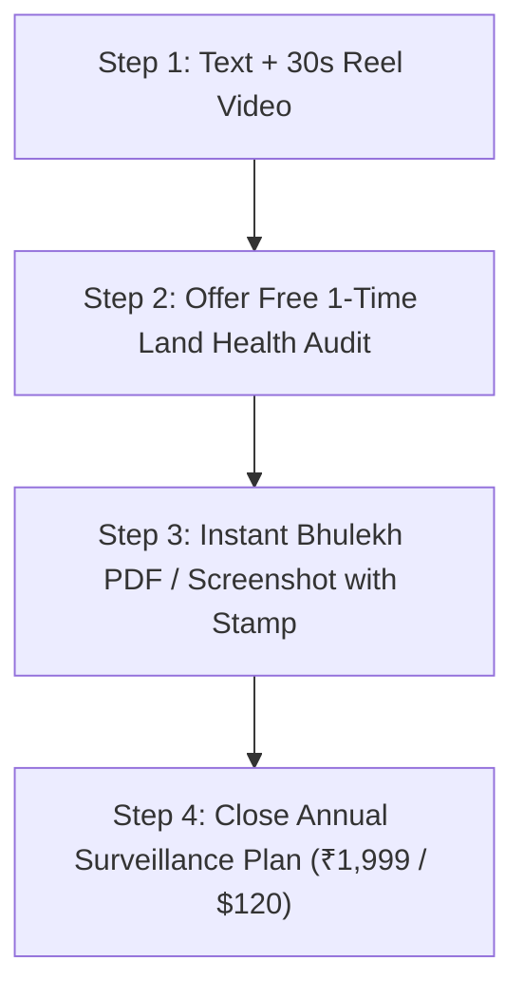

# 🌍 NRI & Domestic Landowner Direct Outreach Playbook
### High-Impact Messaging & Feature Conversion Guide for ज़मीन सेवा केंद्र (Zameen Seva Kendra)

---

## 🎯 1. The Core Psychology: Why NRIs & City Professionals Convert Fast

### The Psychological Vulnerability:
1. **Physical Helplessness**: An NRI in the USA/Dubai or a software engineer in Bengaluru **cannot visit the Tehsil** to inspect land records or Khatauni registers.
2. **The "Cousin / Relative" Trap**: Most people rely on a local relative to "watch" the land. In reality, **over 60% of illegal mutations are initiated by relatives or corrupt neighbors** using fake forged wills (फर्जी वसीयत) or forged power-of-attorney.
3. **The 30-Day Legal Trap (धारा 35 विधिक जाल)**: Under Indian State Revenue Codes (e.g. UP Revenue Code Section 35), whenever an application for mutation (दाखिल-खारिज) is filed, the court issues a **general proclamation**—**not a personal phone call or WhatsApp message**. If no objection (आपत्ति) is filed within **30 days**, the Tehsildar passes an order transferring the ownership!
4. **The Extreme Asymmetry of Value**:
   - Ancestral Land Value: **₹50 Lakhs to ₹5 Crores+**
   - Cost of Court Litigation (15–20 years): **₹5 Lakhs – ₹15 Lakhs**
   - Zameen Seva Kendra Protection: **Only ₹1,999/yr (₹5.5/day) for Domestic or $120/yr for NRIs**

---

## 🚀 2. Direct Website Deep Links & Dynamic WhatsApp Links

Always send **direct deep links** that take them straight to the relevant feature, not just a generic homepage.

| Purpose | Direct URL | User Experience |
| :--- | :--- | :--- |
| **Instant Land Enrollment Form** | `https://www.zameensevakendra.in/#enrollSection` | Scrolls directly to the enrollment form with State & Gata selection |
| **NRI Desk & Pricing Plans** | `https://www.zameensevakendra.in/#plansSection` | Displays the $120/yr (NRI) and ₹1,999/yr (Domestic) side-by-side comparison |
| **Direct WhatsApp Concierge (NRI)** | `https://wa.me/917417174025?text=Hello%2C%20I%20am%20an%20NRI%20living%20abroad.%20I%20want%20to%20verify%20and%20monitor%20my%20ancestral%20land%20in%20India.` | Opens WhatsApp with pre-filled NRI verification request |
| **Direct WhatsApp Concierge (Domestic)** | `https://wa.me/917417174025?text=Namaste%2C%20I%20live%20outside%20my%20hometown%20and%20want%20to%20monitor%20my%20village%20land%20records.` | Opens WhatsApp with pre-filled domestic landowner inquiry |

---

## ⚡ Quick 5-Second WhatsApp / SMS Blasts (Ultra-Short & Punchy)

### 🌍 Short Script 1: For NRIs (Living in USA, UK, UAE, Canada)
> **Who is guarding your ancestral land in India while you're abroad? 🇮🇳**
> 
> Under Section 35, if anyone files a fake mutation or forged will in Tehsil, you get **only 30 days** to object before ownership transfers—no notice is sent overseas!
> 
> 🏛️ **Zameen Seva Kendra** tracks your Khatauni 24/7 and sends instant WhatsApp Red Alerts the second an application is filed.
> 
> 👉 **Check land status & activate protection ($120/yr):**  
> https://www.zameensevakendra.in/#enrollSection  
> 📲 WhatsApp: +91 7417174025

---

### 🇮🇳 Short Script 2: For Domestic Professionals (Bangalore, Mumbai, Delhi, etc.)
> **क्या आपकी पुश्तैनी ज़मीन गाँव में है और आप शहर में नौकरी कर रहे हैं? 🚨**
> 
> तहसील में किसी ने भी फर्जी वसीयत या दाखिल-खारिज की अर्जी डाली, तो आपत्ति के लिए **सिर्फ 30 दिन** मिलते हैं—बिना बताए नाम बदल जाता है!
> 
> 🏛️ **'ज़मीन सेवा केंद्र'** 24 घंटे आपकी खतौनी स्कैन करता है और अर्जी आते ही तुरंत WhatsApp रेड अलर्ट देता है।
> 
> 👉 **मात्र ₹5.5/दिन (₹1,999/वर्ष) में सुरक्षा कवच चालू करें:**  
> https://www.zameensevakendra.in/#enrollSection  
> 📲 WhatsApp: 7417174025

---

## 📲 3. Detailed Message Templates (For Email / InMail / Long WhatsApp)

### 🅰️ Template 1: For NRIs (Living in USA, UK, Canada, UAE, Singapore)
**Channels**: WhatsApp, LinkedIn InMail, Instagram DM, Facebook Groups (e.g., Indians in Bay Area, Indians in Dubai).

```text
Subject / Hook: Who is guarding your ancestral land back in India while you are in [USA / UAE / UK]? 🇮🇳

Namaste Ji,

If your family owns ancestral farmland, plots, or village property in India, there is a critical revenue rule every NRI must know:

⚠️ Under Section 35 of the State Revenue Code, if someone files a fraudulent mutation (फर्जी दाखिल-खारिज या वसीयत) on your land, you get ONLY 30 DAYS to file a legal objection.

No one calls you. No notice is sent to your foreign address. If 30 days pass silently, the land can be legally transferred on government records!

🏛️ ज़मीन सेवा केंद्र (Zameen Seva Kendra) runs 24/7 automated digital surveillance across Indian State Bhulekh portals:
✅ Nightly sync of your Khatauni & mutation records
✅ Instant WhatsApp & Email Red Alerts the moment any application is filed in your Tehsil
✅ Section 35 Emergency Stay Petition drafting by revenue advocates
✅ Dedicated NRI Desk with quarterly certified land health reports

🛡️ Protect multi-crore ancestral property for just $120/year (approx. ₹30/day).

👉 Check your land status and register in 60 seconds:
https://www.zameensevakendra.in/#enrollSection

Or message our Official Helpdesk directly:
📲 WhatsApp: +91 7417174025 (https://wa.me/917417174025?text=Hi%2C%20I%20am%20an%20NRI%20and%20want%20to%20check%20my%20land)
```

---

### 🅱️ Template 2: For Domestic Professionals (Living in Bengaluru, Mumbai, Delhi, Pune)
**Channels**: WhatsApp, LinkedIn DM, Telegram, Housing Society Groups.

```text
Hook: क्या आपकी पुश्तैनी ज़मीन गाँव में है और आप नौकरी शहर (Bengaluru / Delhi / Mumbai) में कर रहे हैं? 🚨

नमस्ते [Name] जी,

गाँव की ज़मीन पर सबसे बड़ा खतरा तब होता है जब भूस्वामी शहर में नौकरी कर रहा हो। 

कानून के मुताबिक (धारा 35), अगर तहसील में किसी ने आपकी ज़मीन पर फर्जी वसीयत या बैनामा दिखाकर दाखिल-खारिज (Mutation) की अर्जी डाल दी, तो आपत्ति दर्ज करने के लिए केवल 30 दिन का समय मिलता है।

30 दिन बाद न्यायालय रिकॉर्ड पर दूसरा नाम दर्ज कर देता है, और फिर 15-20 साल कचहरी के चक्कर काटने पड़ते हैं!

🏛️ 'ज़मीन सेवा केंद्र' आपके गाटा संख्या की 24/7 डिजिटल निगरानी करता है:
🔹 हर रात सरकारी भूलेख पोर्टल से रिकॉर्ड की डिजिटल जांच
🔹 कोई भी अर्जी आते ही तुरंत आपके WhatsApp पर 'रेड अलर्ट'
🔹 किसी तहसील के चक्कर काटने की ज़रूरत नहीं
🔹 शुल्क: मात्र ₹5.5 रोज़ाना (₹1,999/वर्ष)

👉 अभी अपनी ज़मीन का विवरण दर्ज करें और सुरक्षा कवच चालू करें:
https://www.zameensevakendra.in/#enrollSection

सहायता एवं नि:शुल्क प्राथमिक जांच हेतु संपर्क करें:
📞 हेल्पलाइन / WhatsApp: 7417174025
https://wa.me/917417174025?text=Namaste%2C%20I%20want%20to%20check%20my%20village%20land%20records
```

---

### 🅲 Template 3: The Short & Punchy WhatsApp Blast (With Video Reel Attached)
Attach the newly rendered video **`Zameen_Seva_Kendra_Reel.mp4`** with this caption:

```text
🚨 अति आवश्यक सूचना: क्या आपकी पुश्तैनी ज़मीन गाँव में है?

ऊपर दिया गया 30-सेकंड का वीडियो ध्यान से देखें! 👆

तहसील में अवैध दाखिल-खारिज की अर्जी आते ही केवल 30 दिन का समय मिलता है। ज़मीन सेवा केंद्र 24 घंटे आपकी खतौनी और दाखिल-खारिज पर नज़र रखता है—ताकि आपकी अनुपस्थिति में कोई फर्जीवाड़ा न हो सके।

🔍 अपनी ज़मीन की निःशुल्क स्थिति जाँचने के लिए क्लिक करें:
👉 https://www.zameensevakendra.in/#enrollSection

📞 हेल्पलाइन: 7417174025
```

---

## 💎 4. The 4-Step "Impressive Demo" Conversion Flow

When an NRI or Indian professional replies to your text, follow this exact 4-step technique to close the enrollment immediately:



### Step 1: Hook them with the Video & Law Fact
- Send the message with the **30-second official Gazette reel** (`Zameen_Seva_Kendra_Reel.mp4`).
- Seeing the professional Government-style masthead, the Bhulekh scanning beam, and the WhatsApp alert mockup immediately builds 100% trust.

### Step 2: The "Trojan Horse" Offer: Free 1-Time Land Health Audit
Reply with:
> *"Sir, if you have your **District, Tehsil, Village Name, and Gata / Khasra Number**, send it right here. We will run an immediate official search on the State Revenue Council database and send you your live Khatauni & Mutation status in 10 minutes—free of charge."*

### Step 3: Deliver the "Awe" Factor
1. Look up their land on the state portal (UP Bhulekh, MP Bhulekh, Bihar Bhumi, etc.).
2. Generate a clean Khatauni report.
3. Message them:
   > *"Good news, your land currently shows 0 pending disputes. However, the last entry was updated in [Year]. To ensure that no unauthorized mutation or mortgage application is filed in your absence over the next 365 days, our automated sentinel can monitor it 24/7 for ₹8/day."*

### Step 4: One-Click Payment Link
Send the direct link to the checkout or QR code:
- For Domestic: `https://www.zameensevakendra.in/#enrollSection` (or instant UPI ID / QR)
- For NRIs: Send payment link via Stripe / International Card ($120 USD).

---

## 📍 5. Where to Find High-Net-Worth NRIs & Landowners

| Channel | Target Group / Search Queries | Action |
| :--- | :--- | :--- |
| **LinkedIn Search** | Search: `"Software Engineer" OR "Manager"` + `"Bengaluru" OR "Hyderabad"` + Education: `"AKTU" OR "UP Technical University" OR "IIT BHU" OR "NIT Allahabad"` | Message them Template 2. They earn ₹25L–₹60L/yr and have ancestral land in UP/Bihar. |
| **NRI Groups on Facebook** | • Indians in USA (Dallas, Bay Area, New Jersey)<br>• Indians in Dubai & UAE<br>• NRIs from Uttar Pradesh / Punjab in UK & Canada | Share the video reel with Template 1. |
| **WhatsApp Community Groups** | • Regional community groups (Awadh Samaj, Purvanchal Sabha, Brahmin/Kshatriya/Jaat/Yadav diaspora groups). | Post the 30-sec reel + short text. |
| **Property & Legal Forums** | Quora & Reddit threads: `"How to protect ancestral land in India"`, `"NRI property disputes India"`. | Reply authoritatively linking to `zameensevakendra.in`. |

---

## 🛡️ Summary Checklist for Every Outreach Message

- [x] **Always include the 30-day Section 35 law hook** (creates urgency without being misleading).
- [x] **Always attach the 30-second Video Reel** (`Zameen_Seva_Kendra_Reel.mp4`).
- [x] **Use deep links directly to `#enrollSection`** so the user doesn't get lost on the page.
- [x] **Include the clickable WhatsApp link** (`https://wa.me/917417174025`) for instant zero-friction chats.
- [x] **Anchor the price**: Frame it as *"₹8 per day to safeguard a ₹1 Crore asset"*.
